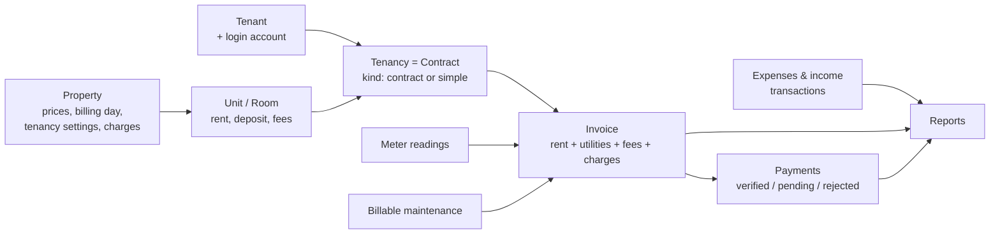
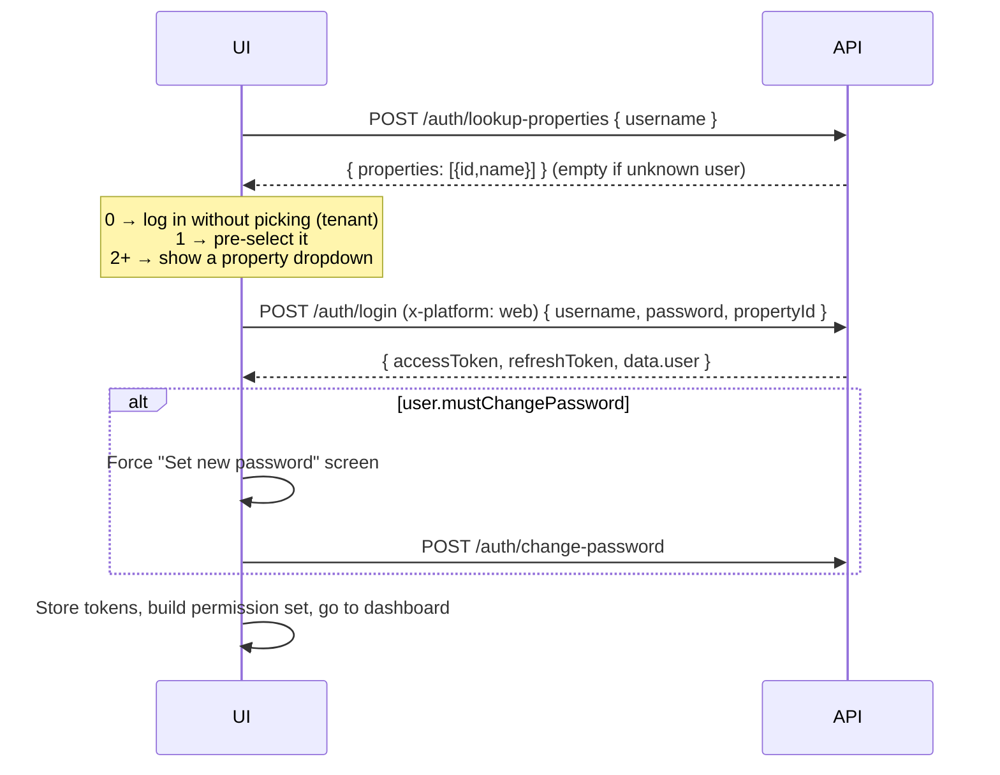
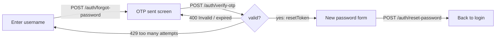
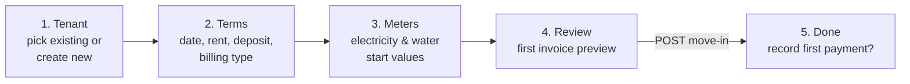
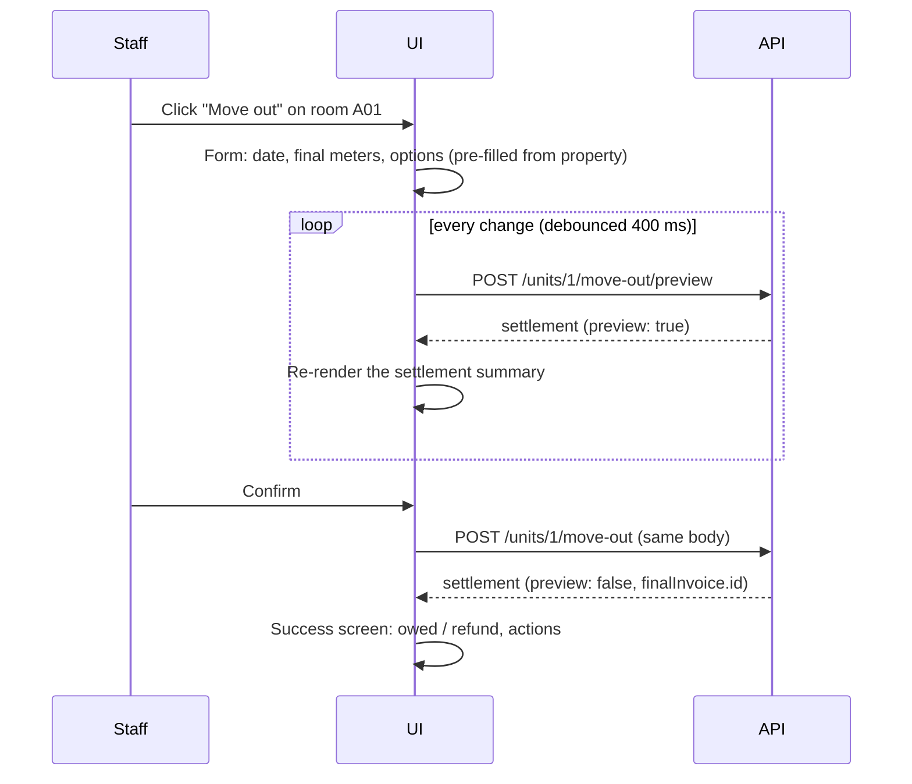
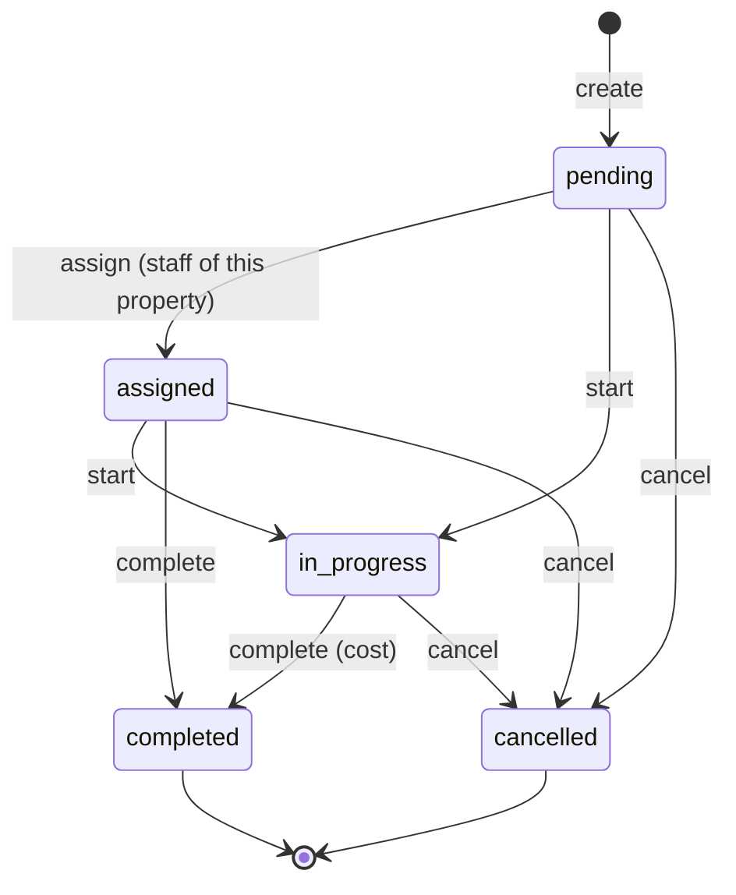
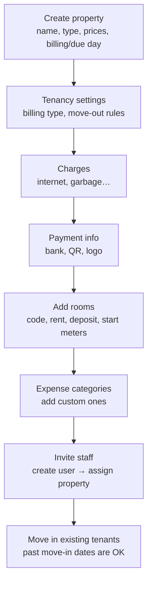
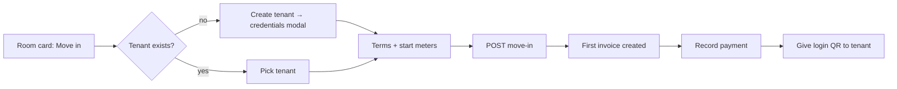
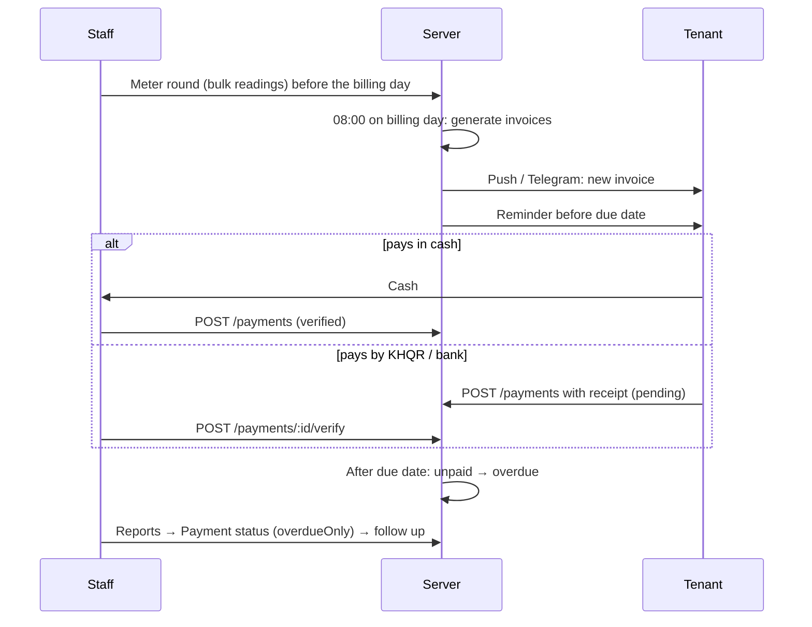

# Pteah Manager — Frontend Guide

This guide is for the frontend team building the **staff web dashboard**, the **owner mobile app** and the **tenant mobile app**. It covers every API module, the business rules behind it, the user flows end to end, and suggested screens.

- Full response schemas for every report are in [REPORTS_API.md](./REPORTS_API.md). This guide covers how the report screens fit into the app.
- All examples use `2026-11` dates. All money is **USD** unless the field name says `Khr`.

---

## Table of contents

1. [How the system works (5-minute overview)](#1-how-the-system-works)
2. [API conventions](#2-api-conventions)
3. [Authentication & session](#3-authentication--session)
4. [Permissions & navigation](#4-permissions--navigation)
5. [Property scope (the current property)](#5-property-scope)
6. [Properties, settings & charges](#6-properties-settings--charges)
7. [Units (rooms)](#7-units-rooms)
8. [Tenants & occupants](#8-tenants--occupants)
9. [Move in / move out](#9-move-in--move-out)
10. [Contracts (formal)](#10-contracts-formal)
11. [Meter readings](#11-meter-readings)
12. [Invoices](#12-invoices)
13. [Payments](#13-payments)
14. [Maintenance](#14-maintenance)
15. [Expenses & income (transactions)](#15-expenses--income-transactions)
16. [Dashboard & finance](#16-dashboard--finance)
17. [Reports](#17-reports)
18. [Announcements, notifications & Telegram](#18-announcements-notifications--telegram)
19. [Users, roles & permissions](#19-users-roles--permissions)
20. [Tenant app (`/me`)](#20-tenant-app-me)
21. [End-to-end process flows](#21-end-to-end-process-flows)
22. [Status & enum reference (with colours)](#22-status--enum-reference)
23. [Error handling](#23-error-handling)
24. [Suggested frontend architecture](#24-suggested-frontend-architecture)
25. [QA checklist](#25-qa-checklist)

---

## 1. How the system works



The key ideas:

| Concept | What the UI needs to know |
|---|---|
| **Property** | A building. Owns the prices (electricity, water, exchange rate), billing rules and recurring charges. Staff only see properties they're **assigned** to. |
| **Unit** | A room in a property. Has a listed rent, deposit and optional per-room fees. Status is `Available`, `Occupied`, `Reserved` or `Maintenance`. **The server sets `Occupied`/`Available` from tenancies**, so the UI should not offer them as manual choices. |
| **Tenant** | A person. Creating a tenant **also creates a login account** (username = phone number) and returns a one-time password and QR code. |
| **Tenancy (Contract)** | Links a tenant to a unit. There are two kinds: `contract` (formal, with end date, terms and PDF) and `simple` (just move in / move out). Both bill the same way. |
| **Invoice** | Created **automatically every day at 08:00** by the server for every active tenancy whose billing day is today. Contains rent (in advance), utility usage (after use), fees, property charges and billable maintenance. |
| **Payment** | Staff payments are verified straight away. Tenant payments wait for staff to verify them. Partial payments are fine; overpayment is blocked. |
| **Transaction** | A manual expense or income entry, linked to a property or a room. Completed maintenance with a cost creates one automatically. |

### Daily server jobs (08:00)

The UI doesn't trigger these, but it should expect their effects:

1. Contracts whose end date has passed become `Expired`.
2. Unit statuses are re-synced from tenancies.
3. **Invoices are generated:**
   - `anniversary` billing: on the tenant's move-in day each month (29th–31st falls back to the last day of shorter months).
   - `unified` billing: on the property's `billingDay`.
4. Unpaid invoices past their `dueDate` become `overdue`.
5. Due-date reminders are sent (push / Telegram).

---

## 2. API conventions

### Base URL and headers

```
Base URL: https://<host>/api/v1
```

| Header | When | Value |
|---|---|---|
| `Authorization` | Every request except login, refresh, forgot/verify/reset password and lookup-properties | `Bearer <accessToken>` |
| `Content-Type` | JSON bodies | `application/json` |
| `Content-Type` | File uploads | `multipart/form-data` (let the browser set the boundary) |
| `x-platform` | **Required on `POST /auth/login`** | `web` or `mobile` |
| `x-device-id` | Login from mobile (or send `deviceId` in the body) | A stable device ID |

### Language

Add `lang=kh` (query string or body) to get **Khmer error messages**. Default is English. The Excel report exports also use `lang=kh` for Khmer labels.

### Response shapes

**Success, single record**

```json
{ "status": "success", "data": { "<key>": { ... } } }
```

**Success, list**

```json
{ "status": "success", "result": 20, "total": 134, "data": { "<pluralKey>": [ ... ] } }
```

- `result` is the number of rows in this page. `total` is the count of all matching rows, so use it for pagination.
- A few custom lists (`/me/*`, `/tenants/:id/invoices`, `/properties/:id/charges`) return `result` without `total`.

**Delete**: `204 No Content`, with **no body**. Don't try to parse JSON. The exception: deleting a record that other records still point to (for example a unit that has contracts) returns `200` with `{ "message": "units soft-deleted (referenced)" }`.

**Error**

```json
{ "status": "fail", "message": "Payment exceeds the remaining balance. Maximum allowed is 30.00." }
```

`status` is `"fail"` for 4xx and `"error"` for 5xx. Always show `message` to the user. It is already translated when you send `lang=kh`.

### The `data` key differs between endpoints

The generic handlers name the key after the model in **plural form, even for a single record** (`GET /units/5` returns `data.units`, an object). Custom handlers use the singular. Use a helper instead of hard-coding:

```ts
// Takes the only value inside `data`, whatever its key is
export const unwrap = <T>(res: { data: { data: Record<string, unknown> } }): T =>
  Object.values(res.data.data ?? {})[0] as T;
```

| Endpoint | Key |
|---|---|
| `GET/PATCH /properties/:id`, `POST /properties` | `properties` (object) |
| `GET/PATCH /units/:id`, `POST /units` | `units` (object) |
| `GET/PATCH /tenants/:id` | `tenants` (object) |
| `POST /tenants` | `tenant` + `credentials` (two keys, so don't use `unwrap`) |
| `GET/POST/PATCH /contracts…`, `PATCH /contracts/:id/terminate` | `contracts` (object) |
| `GET/POST /invoices…` | `invoice` (PATCH: `invoices`) |
| `POST/PATCH /payments…`, `POST /payments/:id/verify` | `payment` (GET one: `payments`) |
| `GET /utility-readings/:id` | `utilityReadings` (POST/PATCH: `utilityReading`; bulk: `readings`) |
| `GET /maintenance` | `maintenanceRequests` (list); actions return `maintenance` |
| `GET/PATCH /transactions/:id` | `transactions` (object); POST: `transaction` |
| `PATCH /transaction-categories/:id` | `data` |
| `/properties/:propertyId/charges` | `charges` (list) / `charge` |
| `POST /units/:id/move-in` | `contract` + `firstInvoice` |
| `POST /units/:id/move-out[/preview]` | `settlement` |

### List query parameters (all generic list endpoints)

| Param | Example | Notes |
|---|---|---|
| `page` | `2` | Default `1` |
| `limit` | `20` | Default **100**, max **1000** |
| `sort` | `-createdAt,unitCode` | `-` = descending. Default newest first. Only real column names work. |
| `fields` | `id,unitCode,status` | Only these columns are returned |
| `search` | `dara` | Case-insensitive "contains" across text columns (some lists search specific fields, see each module) |
| any column | `status=Active` | Exact match on a column |
| operators | `monthlyRent[gte]=100` | `gte`, `gt`, `lte`, `lt` |
| `from` / `to` | `from=2026-11-01&to=2026-11-30` | Filters `createdAt` (or `date`). Exception: `/transactions` filters `transactionDate`. |
| `period` | `last3Months` | `lastMonth`, `last3Months`, `last6Months`, `lastYear` |
| `propertyId` | `1` | Most lists; see [Property scope](#5-property-scope) |
| `meta` | `true` | Include `createdBy` / `updatedBy` |

Unknown parameters are silently ignored, so typos fail quietly. Check your filter names.

### Data types

| Thing | Format | Tip |
|---|---|---|
| Money from DB columns | **String** like `"120.00"` | Always `Number(v)`. Format with `Intl.NumberFormat('en-US', { style: 'currency', currency: 'USD' })` |
| Money computed by the server (balances, reports) | Number | Still safe to wrap in `Number()` |
| Dates (`DATEONLY`) | `YYYY-MM-DD` | Don't convert to `Date` in local time; you'll shift a day. Treat as strings or parse with dayjs as a local date. |
| Timestamps | ISO 8601 UTC | Display in local time (Asia/Phnom_Penh) |
| Billing month | `YYYY-MM` | Final invoices use `YYYY-MM-DD` (the move-out date) |
| Booleans in multipart | `"true"` / `"false"` strings | The server accepts both |
| Arrays/objects in multipart | JSON string | e.g. `occupants` on tenant create |

### Images and files

Uploaded files are stored as a **relative path** like `images/units/abc.jpeg` or `myprefix/images/...`. Build the URL from the API origin (not `/api/v1`):

```ts
export const fileUrl = (path?: string | null) =>
  path ? `${API_ORIGIN}/${path.replace(/^\/+/, '')}` : undefined;
```

Image URLs are public (no auth header), so they work directly in ``.

| Upload | Endpoint | Multipart field(s) | Accepts |
|---|---|---|---|
| Property logo / payment QR | `POST/PATCH /properties` | `logo`, `paymentQrCode` | images (resized to 800px) |
| Tenant ID card | `POST/PATCH /tenants` | `idCardPassport` | images |
| Occupant ID card | `POST/PATCH /occupants` | `idCardPassport` | images |
| Contract PDF | `POST/PATCH /contracts` | `contractPdf` | **PDF only** |
| Payment receipt | `POST /payments` | `attachment` | images |
| Meter photo (single) | `POST/PATCH /utility-readings` | `photo` | images (1200px) |
| Meter photos (bulk) | `POST /utility-readings/bulk` | `electricityPhoto`, `waterPhoto` | images |
| Announcement / template image | `POST/PATCH /announcements`, `/announcement-templates` | `image` | images |

Expense `attachment` on transactions is a plain string field (no upload endpoint). Upload elsewhere or leave empty.

---

## 3. Authentication & session

### Endpoints

| Method | Endpoint | Auth | Body |
|---|---|---|---|
| POST | `/auth/lookup-properties` | – | `{ username }` → `{ properties: [{ id, name }] }` |
| POST | `/auth/login` | – (+ `x-platform`) | `{ username, password, propertyId?, deviceId?, fcmToken? }` |
| POST | `/auth/refresh` | – | `{ refreshToken }` → new `accessToken` + `refreshToken` |
| POST | `/auth/logout` | ✓ | – |
| POST | `/auth/switch-property` | ✓ | `{ propertyId }` → `{ propertyId }` |
| POST | `/auth/change-password` | ✓ | `{ currentPassword, newPassword, confirmPassword }` |
| POST | `/auth/forgot-password` | – | `{ identifier }` (username) |
| POST | `/auth/verify-otp` | – | `{ identifier, otp }` → `{ resetToken }` |
| POST | `/auth/reset-password` | – | `{ identifier, resetToken, newPassword, confirmPassword }` |
| GET / PATCH | `/users/me` | ✓ | Profile and settings |

### Login flow (staff)

Staff (`type: "system_user"`) **must choose a property when logging in**. Tenants don't.



**Login screen suggestion**

```
┌──────────────────────────────┐
│        [ Logo ]               │
│  Username / phone  [_______] │  ← on blur: lookup-properties
│  Password          [_______] │
│  Property          [ ▼ 7743 ]│  ← only shown when 2+ properties
│  [ Log in ]                   │
│  Forgot password?             │
└──────────────────────────────┘
```

`lookup-properties` returns an empty list for unknown usernames, so it can't be used to discover accounts. Don't show "user not found" from it.

### Login response (`data.user`)

```json
{
  "id": 3,
  "username": "sokdara",
  "roleId": 2,
  "isActive": true,
  "mustChangePassword": false,
  "tenant": null,
  "role": {
    "id": 2, "name": "Manager", "description": "...",
    "permissions": {
      "pms": {
        "units": [ { "name": "view units", "description": "...", "scope": "...", "index": 1 } ]
      }
    }
  },
  "settings": { "language": "en", "theme": "light", "notify": true, "deviceId": null, "currentPropertyId": 1 },
  "currentPropertyId": 1,
  "isTelegramLinked": false
}
```

- `tenant` is filled for tenant accounts. Use it to route to the tenant app.
- `role.permissions` is grouped as `type → feature → [permission]`. Flatten it into a `Set` of names (see [§4](#4-permissions--navigation)).

### Login errors to handle

| Status | Meaning | UI |
|---|---|---|
| 400 | Missing `x-platform`, missing username/password, or missing `propertyId` for staff | Show message |
| 401 | Wrong username or password | "Incorrect username or password" |
| 403 | Account inactive, locked, or temporarily locked, or not assigned to that property | Show message; for a lockout, suggest trying later or contacting an admin |
| 404 | Property not found | Reload property list |

**Lockout rules:** 5 wrong passwords lock the account for 1 hour. The next lockouts last 1 day, then 2 days. After the 4th lockout the account is locked until an admin unlocks it.

### Tokens

- Keep the access token in memory (or secure storage on mobile) and the refresh token in secure storage.
- On `401` with a "token expired" message, call `/auth/refresh` **once**, retry the request, and log out if refresh fails.
- **Refresh rotates both tokens.** Save the new refresh token every time. Using an old one fails.
- `logout` clears the refresh token on the server, so every device of that user is logged out on their next refresh.
- Changing the password invalidates existing access tokens (`401`).

```ts
let refreshing: Promise<string> | null = null;

api.interceptors.response.use(undefined, async (err) => {
  const original = err.config;
  if (err.response?.status !== 401 || original._retried || original.url.includes('/auth/')) throw err;
  original._retried = true;
  refreshing ??= axios
    .post(`${BASE}/auth/refresh`, { refreshToken: tokens.refresh })
    .then((r) => { tokens.set(r.data.accessToken, r.data.refreshToken); return r.data.accessToken; })
    .finally(() => { refreshing = null; });
  try {
    const access = await refreshing;
    original.headers.Authorization = `Bearer ${access}`;
    return api(original);
  } catch {
    auth.logout();
    throw err;
  }
});
```

### Forgot password flow



- `forgot-password` always answers success, even for unknown users. Show "If the account exists, an OTP was sent."
- Calling it again too soon returns `429` (cooldown). Show a countdown on the "Resend" button.
- Use a 6-box OTP input.

### Switching property

`POST /auth/switch-property { propertyId }` changes the user's current property. After it succeeds, **clear all cached queries** and reload the current page's data.

---

## 4. Permissions & navigation

The server checks permissions **by name**. Hide what the user can't use, but still handle `403`.

```ts
export function permissionSet(user): Set<string> {
  const out = new Set<string>();
  Object.values(user.role?.permissions ?? {}).forEach((features: any) =>
    Object.values(features).forEach((list: any) => list.forEach((p: any) => out.add(p.name))),
  );
  return out;
}
export const can = (perms: Set<string>, name: string) => perms.has(name);
```

### Permission names

| Area | Permissions |
|---|---|
| Properties | `view properties`, `create property`, `edit property`, `delete property` |
| Units | `view units`, `create unit`, `edit unit`, `delete unit` |
| Tenants | `view tenants`, `create tenant`, `edit tenant`, `delete tenant` |
| Occupants | `view occupants`, `create occupant`, `edit occupant`, `delete occupant` |
| Contracts & move in/out | `view contracts`, `create contract` (also move-in), `edit contract` (also move-out), `delete contract` |
| Meter readings | `view utility readings`, `create utility reading`, `edit utility reading`, `delete utility reading` |
| Invoices | `view invoices`, `create invoice`, `edit invoice`, `delete invoice` |
| Payments | `view payments`, `create payment`, `edit payment`, `delete payment`, `verify payment` |
| Maintenance | `view maintenances`, `create maintenance`, `edit maintenance`, `delete maintenance` |
| Expenses / income | `view transactions`, `create transaction`, `edit transaction`, `delete transaction` |
| Categories | `view transaction categories`, `create transaction category`, `edit transaction category`, `delete transaction category` |
| Reports | `view reports` |
| Owner dashboard | `view dashboard` (only `/dashboard/owner-mobile`) |
| Announcements | `view announcements`, `create announcement`, `edit announcement`, `delete announcement`, `create announcement-template`, `edit announcement-template`, `delete announcement-template` |
| Notifications | `create notification` |
| Users | `view users`, `create user`, `edit user`, `delete user`, `assign properties` |
| Roles | `view roles`, `create role`, `edit role`, `delete role`, `assign permission` |
| Permissions | `view permissions`, `create permission`, `edit permission`, `delete permission` |
| System | `view system configs`, `edit system config` |

### Suggested navigation (staff web)

```
┌───────────────────────────────────────────────────────────────┐
│ [Logo]  Property: [ 7743 A&B ▼ ]           🔔  [EN|ខ្មែរ]  (SD)▼│
├──────────────┬────────────────────────────────────────────────┤
│ 🏠 Dashboard  │                                                │
│ 🏢 Rooms      │   (page content)                               │
│ 👤 Tenants    │                                                │
│ 📄 Contracts  │                                                │
│ ⚡ Meters     │                                                │
│ 🧾 Invoices   │                                                │
│ 💵 Payments  ③│  ← badge = pending payments to verify          │
│ 🔧 Maintenance│                                                │
│ 💸 Expenses   │                                                │
│ 📊 Reports    │                                                │
│ 📢 Announce   │                                                │
│ ⚙️ Settings   │  → Property, Charges, Categories, Users, Roles │
└──────────────┴────────────────────────────────────────────────┘
```

| Menu | Show when the user has |
|---|---|
| Dashboard | always (`/dashboard/overview` needs only login) |
| Rooms | `view units` |
| Tenants | `view tenants` |
| Contracts | `view contracts` |
| Meters | `view utility readings` |
| Invoices | `view invoices` |
| Payments | `view payments` |
| Maintenance | `view maintenances` |
| Expenses | `view transactions` |
| Reports | `view reports` |
| Announcements | `view announcements` |
| Settings → Property | `view properties` |
| Settings → Users / Roles | `view users` / `view roles` |

---

## 5. Property scope

A staff user only ever sees data from properties they're **assigned** to. There are two ideas:

| Idea | Where | Use it for |
|---|---|---|
| **Current property** | `user.currentPropertyId`, changed with `/auth/switch-property` | The default for creating things (units, tenants, expenses) and for single-property screens |
| **Report/list scope** | `?propertyId=1`, `?propertyIds=1,2`, or nothing (= all assigned) | Reports, dashboard, transactions; most lists accept `propertyId` |

Rules the UI should rely on:

- A record from another property returns **`404`**, the same as a missing record. Treat `404` on a detail page as "not found or no access".
- Pointing a create/edit at another property's `propertyId`, `unitId`, `tenantId`, `contractId` or `invoiceId` returns `403` or `404`.
- **Creating a property assigns it to its creator**, so the new property appears in the switcher right away (refresh `/form-options/pms?includes=properties`).
- If an admin removes the user from their current property, the server stops trusting it. Creates that rely on the current property fail with "propertyId is required". Send the user to the property switcher when this happens.

### Header property switcher

```
Property: [ 7743 A&B ▼ ]
          ├ 7743 A&B         ✓
          ├ Riverside
          └ ─────────────
            All my properties   (reports & dashboard only)
```

Get the list from `GET /form-options/pms?includes=properties`.

### Form options (dropdown data)

`GET /form-options/pms?includes=properties,units,tenants,users,roles,floors,vehicle_types`

| Key | Shape | Use for |
|---|---|---|
| `properties` | `[{ id, name }]` | Property pickers |
| `units` | `[{ id, unitCode, propertyId }]` | Room pickers (filter by `propertyId` on the client) |
| `tenants` | `[{ id, name, phoneNumber }]` | Tenant pickers |
| `users` | `[{ id, username }]` | Maintenance assignee |
| `roles` | `[{ id, name }]` | User form |
| `floors` | `["1", "2", "Ground"]` | Floor filter |
| `vehicle_types` | `["Motorcycle","Car","Bicycle","Other"]` | Tenant / occupant vehicle |

Leave out `includes` to get everything. Cache it per property and refetch after creating a unit or tenant.

---

## 6. Properties, settings & charges

### Endpoints

| Method | Endpoint | Permission |
|---|---|---|
| GET | `/properties` | `view properties` (includes `units`) |
| GET | `/properties/:id` | `view properties` |
| POST | `/properties` (multipart if uploading `logo` / `paymentQrCode`) | `create property` |
| PATCH | `/properties/:id` | `edit property` |
| DELETE | `/properties/:id` | `delete property` (also deletes its units) |

### Fields

| Field | Type | Default | Notes |
|---|---|---|---|
| `name` | string | – | **Required** |
| `type` | `Apartment` \| `Room Rental` \| `Shop House` \| `Villa` \| `Land` | – | **Required** |
| `address`, `description` | text | | |
| `numberOfFloors`, `totalUnits` | int | | Informational |
| `ownerName`, `ownerPhone` | string | | |
| `status` | `Active` \| `Maintenance` | `Active` | |
| `electricityPricePerKwh` | decimal | 0 | USD per kWh |
| `waterPricePerM3` | decimal | 0 | USD per m³ |
| `exchangeRate` | int | 4000 | KHR per USD, used for `totalAmountKhr` on invoices |
| `billingDay` | 1–28 | 1 | Billing day for `unified` billing |
| `dueDay` | 1–28 | 5 | Due day for regular invoices (see [Due dates](#due-dates)) |
| `reminderBeforeDueDays` | int | 1 | Reminder this many days before the due date |
| `defaultBillingStrategy` | `anniversary` \| `unified` | `anniversary` | See [§9](#property-tenancy-settings) |
| `defaultMoveOutRentMode` | `prorated` \| `full` \| `none` | `prorated` | |
| `autoApplyDeposit` | bool | false | |
| `dailyRateBasis` | `actual` \| `fixed30` | `actual` | |
| `refundUnusedDays` | bool | false | |
| `bankName`, `bankAccountName`, `bankAccountNumber` | string | | Shown on invoices / tenant app |
| `paymentQrCode`, `logo` | image path | | Upload via multipart |

### Property settings screen (suggested tabs)

```
Settings › Property: 7743 A&B
┌ General ─┬ Billing & prices ─┬ Move-in / move-out ─┬ Charges ─┬ Payment info ┐
```

**Billing & prices**

```
Electricity price  [$ 0.25 ] per kWh      Water price [$ 0.50 ] per m³
Exchange rate      [ 4100 ] ៛ per $1
Billing day        [ 1  ▼ ]  (used by "Same day for everyone" billing)
Due day            [ 5  ▼ ]
Remind tenants     [ 1 ] day(s) before the due date
```

**Move-in / move-out** (plain-language labels work better than the field names)

```
How do new tenants pay rent?
 (•) From their move-in day, a full month in advance          ← anniversary
 ( ) Everyone on the billing day; first month is prorated     ← unified

When a tenant stays past their paid month, charge the extra days:
 (•) Only the extra days (prorated)   ( ) A full month   ( ) Nothing

Daily rate   (•) Monthly price ÷ days in that month   ( ) Monthly price ÷ 30

[ ] Use the deposit to pay what's still owed at move-out
[ ] Refund unused days when a tenant leaves early
```

Save with one `PATCH /properties/:id`. These are **defaults**; staff can override them on each move-in / move-out.

### Property charges (internet, parking, garbage, …)

A charge applies to **every tenant in the property** and appears as its own invoice line (`type: "charge"`).

| Method | Endpoint | Permission | Body |
|---|---|---|---|
| GET | `/properties/:propertyId/charges?active=true` | `view properties` | – |
| GET | `/properties/:propertyId/charges/:id` | `view properties` | – |
| POST | `/properties/:propertyId/charges` | `edit property` | `{ name, amount, isActive? }` |
| PATCH | `/properties/:propertyId/charges/:id` | `edit property` | any of `name`, `amount`, `isActive` |
| DELETE | `/properties/:propertyId/charges/:id` | `edit property` | – |

- `amount` ≥ 0; comes back as a string.
- Changes only affect **invoices created afterwards**.
- **Don't double-bill:** units also have per-room fees (`parkingFee`, `internetFee`, …). Use a property charge when everyone pays, and a unit fee when only some rooms pay. Show a warning in the UI if the same name is used in both places.

```
Charges (added to every tenant's invoice)
┌───────────────┬────────┬────────┬─────────┐
│ Name          │ Amount │ Active │         │
├───────────────┼────────┼────────┼─────────┤
│ Internet      │ $5.00  │  [●]   │ ✎  🗑   │
│ Garbage       │ $1.00  │  [○]   │ ✎  🗑   │
└───────────────┴────────┴────────┴─────────┘
[+ Add charge]        ⓘ Changes apply to new invoices only.
```

Use the toggle to pause a charge (`isActive: false`) instead of deleting it.

---

## 7. Units (rooms)

### Endpoints

| Method | Endpoint | Permission |
|---|---|---|
| GET | `/units?propertyId=1&status=Available` | `view units` |
| GET | `/units/:id` | `view units` |
| POST | `/units` | `create unit` |
| PATCH | `/units/:id` | `edit unit` |
| DELETE | `/units/:id` | `delete unit` |
| POST | `/units/:id/move-in` | `create contract` ([§9](#9-move-in--move-out)) |
| POST | `/units/:id/move-out/preview` | `edit contract` |
| POST | `/units/:id/move-out` | `edit contract` |

List and detail include `property` and `contracts` (only `Active` ones, each with `tenant { id, name, phoneNumber }`). The current tenant is `unit.contracts[0]?.tenant`.

### Fields

| Field | Type | Notes |
|---|---|---|
| `propertyId` | int | Defaults to the current property |
| `unitCode` | string | **Required**, e.g. `A01` |
| `floorNumber`, `roomType`, `size` | string | |
| `monthlyRent`, `dailyRent`, `weeklyRent` | decimal | Listed price; a tenancy can override it |
| `depositAmount` | decimal | Default deposit for move-in |
| `parkingFee`, `internetFee`, `garbageFee`, `managementFee`, `additionalFee` | decimal | Per-room monthly fees; each > 0 becomes an invoice line |
| `startElectricityReading`, `startWaterReading` | decimal | Meter values when the room was first set up |
| `status` | `Available` \| `Occupied` \| `Reserved` \| `Maintenance` | See rules below |
| `notes` | text | |

### Status rules

| Trying to set | Result |
|---|---|
| `Occupied` with no active tenancy | `400` "Cannot set unit to Occupied without an active contract." |
| `Available` while a tenancy is active | `400` |
| `Maintenance` / `Reserved` | Allowed |

In the edit form, only offer **Available / Maintenance / Reserved**. Show "Occupied" as a read-only badge, and change it through move-in / move-out.

### Rooms screen (suggested)

A **grid of room cards** is faster for landlords than a table. Offer a table toggle for bulk work.

```
Rooms — 7743 A&B          [Floor ▼] [Status ▼] [🔍 search]   [+ Add room]
Occupied 14 · Available 2 · Reserved 0 · Maintenance 0

┌──────────┐ ┌──────────┐ ┌──────────┐ ┌──────────┐
│ A01  🟢  │ │ A02  🟢  │ │ A03  ⚪  │ │ A04  🟠  │
│ Chun Mab │ │ Thon N.  │ │ Vacant   │ │ Repair   │
│ $60/mo   │ │ $60/mo   │ │ $55/mo   │ │ $60/mo   │
│ Owes $15 │ │ Paid ✓   │ │[Move in] │ │          │
└──────────┘ └──────────┘ └──────────┘ └──────────┘
```

- Get the "Owes / Paid" line from `/reports/room-tenants` (current month) or `/reports/payment-status`, not by loading every invoice.
- Clicking a card opens the **Room detail drawer**: info, current tenant, the actions **Move in** / **Move out** / **Record meter** / **New maintenance**, and tabs for invoices, readings and history.

---

## 8. Tenants & occupants

### Endpoints

| Method | Endpoint | Permission |
|---|---|---|
| GET | `/tenants?propertyId=1&status=Active` | `view tenants` |
| GET | `/tenants/:id` | `view tenants` (includes `user`, `contracts`, `occupants`) |
| POST | `/tenants` (multipart if uploading ID) | `create tenant` |
| PATCH | `/tenants/:id` | `edit tenant` |
| DELETE | `/tenants/:id` | `delete tenant` |
| GET | `/tenants/:id/invoices?range=3_months` | `view invoices` |
| POST | `/tenants/:id/regenerate-qr` | `edit tenant` |
| CRUD | `/occupants` | `view/create/edit/delete occupant` |

`range` on tenant invoices is **required**: `last_month`, `3_months`, `6_months` or `1_year`.

### Tenant fields

| Field | Type | Notes |
|---|---|---|
| `name` | string | **Required** |
| `phoneNumber` | string | **Required, unique**. Spaces are removed. **Becomes the tenant's login username.** |
| `gender` | `male` \| `female` \| `other` \| null | |
| `idNumber` | string | ID card **number** |
| `idCardPassport` | image | ID card **photo** (multipart) |
| `emergencyContact`, `occupation` | string | |
| `plateNumber`, `vehicleType`, `vehicleModel` | string | |
| `status` | `Active` \| `Moved Out` | Set by move-in / move-out |
| `propertyId` | int | Defaults to the current property; move-in sets it to the room's property |
| `occupants` | array (JSON string in multipart) | Create only: `[{ name, relationship, phoneNumber, plateNumber, vehicleType, vehicleModel }]` |

### Create tenant: the credentials moment

`POST /tenants` returns:

```json
{
  "data": {
    "tenant": { "id": 12, "name": "Chun Mab", "occupants": [], "user": { "id": 40, "username": "0712216892", "qrCode": "tenants/qrs/..." } },
    "credentials": { "username": "0712216892", "password": "k3P9x2Qa", "qrDataURL": "data:image/png;base64,..." }
  }
}
```

**The password is only shown once.** Show it straight away in a modal the user has to dismiss:

```
┌──────────── Tenant created ─────────────┐
│  Give these login details to Chun Mab:   │
│                                          │
│     [  QR code image (qrDataURL)  ]      │
│                                          │
│  Username: 0712216892         [Copy]     │
│  Password: k3P9x2Qa           [Copy]     │
│                                          │
│  [ Print ]  [ Share via Telegram ]       │
│  ⚠ This password won't be shown again.   │
│                    [ Done → Move in now ]│
└──────────────────────────────────────────┘
```

- Errors: `409` "This phone number is already registered." Highlight the phone field.
- "Done → Move in now" leads naturally into the move-in wizard with this tenant selected.
- Lost password: `POST /tenants/:id/regenerate-qr` creates a **new** password and QR (the old one stops working) and returns them in the same format. Ask for confirmation first.
- The tenant must change the password at first login (`mustChangePassword`).

### Tenant detail page

```
← Tenants   Chun Mab  🟢 Active          [Edit] [Reset login] [Move out]
0712216892 · Male · ID 110613676(01)
Room A01 · 7743 A&B · since 16 Oct 2026 · Rent $60 · Deposit $60

[ Overview ] [ Invoices ] [ Payments ] [ Occupants ] [ Documents ]

Balance owed: $15.47   Last payment: 16 Oct 2026
```

---

## 9. Move in / move out

This is the most important flow in the app. Use it for **every** tenant arrival and departure, including tenants with a formal contract (for move-out).

### Property tenancy settings

| Setting | Meaning |
|---|---|
| `anniversary` billing | The tenant pays a **full month in advance from the move-in day** and is billed on that day every month. No proration. |
| `unified` billing | Everyone is billed on the property's `billingDay`. The first month is prorated from the move-in day. |
| `rentMode` (move-out) | How to charge days **after** the paid month: `prorated`, `full`, or `none`. |
| `applyDeposit` | Use the deposit to pay what's still owed, oldest invoice first. |
| `refundUnusedDays` | Refund the unused part of the paid month when leaving early. |
| `dailyRateBasis` | `actual` = price ÷ days in month; `fixed30` = price ÷ 30. |

### Move in

`POST /units/:id/move-in`

| Field | Required | Default | Notes |
|---|---|---|---|
| `tenantId` | ✓ | – | Create the tenant first |
| `moveInDate` | | today | `YYYY-MM-DD`. A past date is fine (entering old records). A future date makes the room `Reserved`. |
| `monthlyRent` | | room's `monthlyRent` | |
| `depositAmount` | | room's `depositAmount` | |
| `startReadings` | | – | `{ electricity, water }` meter values on the move-in day |
| `billingStrategy` | | property default | `anniversary` \| `unified` |
| `createFirstInvoice` | | `true` | Creates the first invoice, due on the move-in day |
| `note` | | – | |

Response `201`: `{ contract, firstInvoice }`. `firstInvoice` is `null` if not created.

| Error | Meaning |
|---|---|
| `409` "This room already has a tenant…" | Someone lives there. Offer to open the move-out flow. |
| `409` "This tenant is already living in another room…" | Show which room, and offer to move them out first. |
| `404` | Unit or tenant not found (or not yours) |
| `400` | Bad date / negative amount / bad strategy |

**Move-in wizard (suggested)**



```
Move in — Room A01                                  Step 2 of 4
──────────────────────────────────────────────────────────────
Tenant          Chun Mab (0712216892)               [change]
Move-in date    [ 16/10/2026 📅 ]
Monthly rent    [ $ 60.00 ]   (room price $60)
Deposit         [ $ 60.00 ]
Billing         (•) From move-in day, full month in advance
                ( ) Same day for everyone (prorated first month)
                    ⓘ Property default: From move-in day
[x] Create the first invoice now
                                     [ Back ]  [ Next → ]
```

Step 3 should pre-fill the last meter values from `GET /utility-readings/last-reading/:unitId`, so staff only correct them.

Step 5: if `firstInvoice` exists, show "First invoice $65.00 (due today)" with a **[Record payment]** button that opens the payment form pre-filled with `firstInvoice.id` and the amount.

### Move out (preview, then confirm)

`POST /units/:id/move-out/preview` and `POST /units/:id/move-out` take **the same body**. The preview saves nothing.

| Field | Default | Notes |
|---|---|---|
| `moveOutDate` | today | Can't be in the future or before the move-in date |
| `finalReadings` | – | `{ electricity, water }` on the leaving day |
| `rentMode` | property default | Only matters if they stay past the paid month |
| `applyDeposit` | property default | |
| `refundUnusedDays` | property default | |
| `discount` | 0 | Extra discount on the final invoice |
| `note` | – | |

**Move-out wizard (suggested)**



```
Move out — Room A01 · Chun Mab                    moved in 16 Oct 2026
─────────────────────────────────────────────┬───────────────────────────
Move-out date   [ 10/11/2026 📅 ]             │  SETTLEMENT (preview)
Final meters    ⚡ [ 1580 ] (last 1550)        │  Paid through   15 Nov 2026
                💧 [   92 ] (last 90)          │  Extra rent     $0.00 ✓ covered
                                              │  ─────────────────────────
Options                                       │  Final invoice
 Extra days after paid month: [Prorated ▼]    │   Electricity 30kWh  $7.50
 [ ] Use deposit to pay what's owed           │   Water 2m³          $1.00
 [ ] Refund unused days                       │  Unpaid earlier       $0.00
 Discount [ $ 0 ]                             │  ─────────────────────────
 Note     [ Moved back home          ]        │  Tenant owes         $8.50
                                              │  Deposit to return  $60.00
                                              │  Refund due now      $0.00
─────────────────────────────────────────────┴───────────────────────────
                                   [ Cancel ]   [ Confirm move-out ]
```

How to read the `settlement` for the summary panel:

| Show | From |
|---|---|
| Paid through | `rent.paidThrough` |
| "Extra rent" line | `rent.charged` (and `rent.extraDays` from `rent.extraFrom`); show "covered" when `rent.coveredByPaidPeriod` |
| Final invoice lines | `finalInvoice.invoiceDetails` (`null` = nothing to charge) |
| Tenant still owes | `outstanding`, with the list in `unpaidInvoices` |
| Deposit | `deposit.amount`, `deposit.applied`, `deposit.refundable` |
| Unused-day credit | `credit` (only when `credit.enabled`) |
| Money to give back now | `refundDue` |
| Settings actually used | `settings` (show as small chips so staff see what was applied) |

After confirming:
- The room becomes `Available`, the tenancy `Terminated`, and the tenant `Moved Out` (unless they rent another room).
- Show actions: **[Record payment for final invoice]**, **[Print settlement]**, **[Go to room]**.
- Refresh the room grid, tenant list and dashboard queries.

The full field list and worked example are in [REPORTS_API.md → Move out](./REPORTS_API.md#move-out-on-any-day).

---

## 10. Contracts (formal)

Use this module when a landlord wants a **formal contract** with an end date, terms and a signed PDF. For a tenant without paperwork, use move-in.

| Method | Endpoint | Permission |
|---|---|---|
| GET | `/contracts?kind=contract&status=Active&propertyId=1` | `view contracts` |
| GET | `/contracts/:id` | `view contracts` |
| POST | `/contracts` (multipart for `contractPdf`) | `create contract` |
| PATCH | `/contracts/:id` | `edit contract` |
| PATCH | `/contracts/:id/terminate` | `edit contract` |
| DELETE | `/contracts/:id` | `delete contract` |

### Fields

| Field | Notes |
|---|---|
| `tenantId`, `unitId`, `startDate`, `monthlyRent` | **Required** |
| `endDate` | Optional; must be after `startDate`. The daily job marks the contract `Expired` after it. |
| `depositAmount`, `terms` | |
| `contractPdf` | PDF upload |
| `status` | `Active` (default), `Expired`, `Terminated` |
| `kind` | `contract` (default) or `simple` (created by move-in) |
| `billingStrategy` | `unified` (default for contracts) or `anniversary` |
| `rentCycle` | `month` (default), `week`, `day` |
| `rentAmount` | Price per cycle for `week` / `day` cycles |

Rules:
- One active tenancy per room, and one per tenant (`409` otherwise).
- Creating an active contract sets the room to `Occupied`.
- **When the tenant leaves, use `POST /units/:id/move-out`**, not terminate. Move-out also creates the final bill and handles the deposit. `terminate` only ends the contract.

### Contracts list (suggested)

```
Contracts   [All | Formal | No contract]  [Active ▼]  [🔍]        [+ New contract]
┌──────┬──────────┬────────┬────────────┬────────────┬────────┬──────────┐
│ Room │ Tenant   │ Rent   │ Start      │ End        │ Kind   │ Status   │
├──────┼──────────┼────────┼────────────┼────────────┼────────┼──────────┤
│ A01  │ Chun Mab │ $60    │ 16/10/2026 │ —          │ Simple │ 🟢 Active │
│ B02  │ Sok Dara │ $120   │ 01/01/2026 │ 31/12/2026 │ Formal │ 🟢 ⚠ 51d │
└──────┴──────────┴────────┴────────────┴────────────┴────────┴──────────┘
```

Show an "expires in N days" warning when `endDate` is within 60 days (the dashboard's `expiringContracts` uses the same window).

---

## 11. Meter readings

Electricity and water are billed **after use**. Staff record readings, and the next invoice bills every reading that hasn't been billed yet.

| Method | Endpoint | Permission |
|---|---|---|
| GET | `/utility-readings?unitId=1&type=electricity&search=A01` | `view utility readings` |
| GET | `/utility-readings/:id` | `view utility readings` |
| GET | `/utility-readings/init/:unitId?billingMonth=2026-11` | `view utility readings` |
| GET | `/utility-readings/last-reading/:unitId` | `view utility readings` |
| POST | `/utility-readings` (multipart `photo`) | `create utility reading` |
| POST | `/utility-readings/bulk` (multipart `electricityPhoto`, `waterPhoto`) | `create utility reading` |
| PATCH | `/utility-readings/:id` | `edit utility reading` |
| DELETE | `/utility-readings/:id` | `delete utility reading` |

Search on the list covers the note, room code and tenant name.

### Recording

**Single:** `{ unitId, type: "electricity" | "water", currentReading, readingDate?, note?, photo? }`

**Both meters at once (recommended):** `POST /utility-readings/bulk`
`{ unitId, electricityReading?, waterReading?, readingDate?, note?, electricityPhoto?, waterPhoto? }` → `{ readings: [...] }`

- The server works out `previousReading` (the last reading, or the room's start value) and `usage`.
- `400` if the new value is lower than the previous one. Validate on the client too, using `/init` or `/last-reading`.
- `invoiceId` on a reading: `null` = not billed yet; a number = billed on that invoice.
- **Editing or deleting is blocked** once the reading is on an invoice that isn't cancelled. Disable the buttons when `invoiceId` is set and show a tooltip: "Already billed on invoice #…".

### `/init/:unitId` (pre-fill for the reading form)

```json
{
  "context": { "property": "7743 A&B", "room": "A01", "floor": "1", "tenant": "Chun Mab", "month": "November 2026" },
  "electricity": { "previousReading": 1550, "pricePerUnit": "0.25" },
  "water": { "previousReading": 90, "pricePerUnit": "0.50" },
  "additionalFees": { "rent": 60, "parking": 0, "internet": 0, "garbage": 0, "management": 0, "additional": 0 },
  "billingInfo": { "billingMonth": "2026-11", "displayMonth": "November 2026", "dueDate": "2026-12-05" },
  "settings": { "exchangeRate": 4000 }
}
```

### Meter round screen (suggested, mobile-first)

Staff walk the building and enter meters room by room. Make it fast:

```
Meter round — Nov 2026 · Floor 1            12 / 16 done  ███████░░
┌──────────────────────────────────────────────────┐
│ A01 · Chun Mab                                   │
│ ⚡ Electricity  last 1550 → [ 1580 ]  = 30 kWh $7.50  [📷] │
│ 💧 Water        last 90   → [   92 ]  = 2 m³   $1.00  [📷] │
│                                    [ Save & next → ]│
└──────────────────────────────────────────────────┘
```

- Load `/init/:unitId` for each room. Show live usage × price as staff type.
- Highlight in red if the value is below the last one, and in amber if usage is more than 3× the room's average (likely a typo).
- Save with `/bulk`, then jump to the next room.
- Allow camera capture for the meter photo (`<input type="file" accept="image/*" capture="environment">`).

---

## 12. Invoices

| Method | Endpoint | Permission |
|---|---|---|
| GET | `/invoices?status=overdue&billingMonth=2026-11&propertyId=1` | `view invoices` |
| GET | `/invoices/:id` | `view invoices` |
| POST | `/invoices` | `create invoice` |
| PATCH | `/invoices/:id` | `edit invoice` |
| DELETE | `/invoices/:id` | `delete invoice` |
| POST | `/maintenance/:id/invoice` | `create invoice` (stand-alone maintenance invoice) |

List and detail include `contract`, `unit` (+ `property`), `tenant`, `payments` and `invoiceDetails`.

### How invoices are created

| Source | When |
|---|---|
| **Daily job** (most invoices) | 08:00 on the billing day, for every active tenancy |
| **Move-in** | First invoice, due on the move-in day (`createFirstInvoice`) |
| **Move-out** | Final invoice (`INV-FINAL-…`), due on the move-out day |
| **Manual** `POST /invoices` | `{ contractId, billingMonth?, dueDate?, discount? }`. Use it for corrections, or if the daily job missed one |
| **Maintenance** | `POST /maintenance/:id/invoice` creates `INV-MANT-…`, due in 3 days |

Only one invoice per tenancy per `billingMonth` (`400` "Invoice already exists…").

### Due dates

A regular invoice is never due before the day it is created. When no `dueDate` is sent:

| Tenancy | Due date | Example (billing day 1, due day 5) |
|---|---|---|
| `unified` billing | The next property `dueDay` on or after the invoice date | Created 1 Nov → due 5 Nov. Created by hand on 10 Nov → due 5 Dec. |
| `anniversary` billing (and day/week rent cycles) | Invoice date + the same grace period unified tenants get between `billingDay` and `dueDay` | Grace = 4 days. Billed on the 16th → due the 20th. |

Move-in invoices are due on the move-in day, final invoices on the move-out day, and maintenance invoices 3 days after creation. Manual `POST /invoices` can still send its own `dueDate`.

In the property settings, show the result next to the fields, e.g. "Tenants billed on their move-in day have 4 days to pay."

### Invoice fields

| Field | Notes |
|---|---|
| `invoiceNumber` | e.g. `INV-202611-A01-000123` |
| `billingMonth` | `YYYY-MM` (final invoices: `YYYY-MM-DD`) |
| `subTotal`, `discount`, `totalAmount` | strings |
| `totalAmountKhr`, `exchangeRate` | KHR total at the invoice's rate |
| `dueDate` | |
| `status` | `draft`, `sent`, `partial`, `paid`, `overdue`, `cancelled` |
| `note` | |
| **Balance fields** (computed) | `paidAmount`, `pendingAmount`, `remainingAmount`, `paymentStatus` (`paid`/`partial`/`unpaid`/`cancelled`), `isOverdue`, `daysOverdue`, `lastPaymentDate` |

### Invoice lines (`invoiceDetails`)

| `type` | Example `description` | Extra fields |
|---|---|---|
| `rent` | `Rent - 2026-11`, `Prorated Rent (16/10 - 31/10)` | |
| `electricity` | `Electricity (50 kWh * $0.25, 2 readings)` | `usage`, `previousReading`, `currentReading`, `readingDate`, `rate` |
| `water` | `Water (3 m³ * $0.5)` | same |
| `parking`, `internet`, `garbage`, `management`, `additional` | `Parking Fee` | per-room fees |
| `charge` | `Internet` | property charges |
| `maintenance` | maintenance description | `maintenanceId` |

### What to show

- For "who paid what", use **`paymentStatus` + `remainingAmount`**.
- Use `status === 'overdue'` / `isOverdue` only for the red overdue warning.
- Editing amounts isn't supported. Change the total with `discount` (PATCH), or cancel with `status: "cancelled"` and create a new one. `unitId`, `contractId`, `tenantId` and `invoiceNumber` can't be changed.
- **Cancelling or deleting** an invoice releases its meter readings, and they go on the next invoice. Say so in the confirm dialog.
- Deleting a `draft` invoice removes it permanently (its number can be reused). Other statuses are soft-deleted.

### Invoices list (suggested)

```
Invoices  [Nov 2026 ▼] [All | Unpaid | Partial | Paid | Overdue]  [Room ▼] [🔍]   [+ Invoice]
┌────────────────────────┬──────┬──────────┬────────┬────────┬────────┬───────────┬────────┐
│ Number                 │ Room │ Tenant   │ Total  │ Paid   │ Left   │ Due       │ Status │
├────────────────────────┼──────┼──────────┼────────┼────────┼────────┼───────────┼────────┤
│ INV-202611-A01-000123  │ A01  │ Chun Mab │ $65.00 │ $30.00 │ $35.00 │ 16/11     │ 🟡 Partial│
│ INV-202611-A02-000124  │ A02  │ Thon N.  │ $60.00 │ $0.00  │ $60.00 │ 05/11 ⚠5d │ 🔴 Unpaid │
└────────────────────────┴──────┴──────────┴────────┴────────┴────────┴───────────┴────────┘
Totals: Invoiced $640 · Collected $355 · Remaining $285
```

For the counters and totals, `/reports/payment-status` is the cheaper source ([§17](#17-reports)).

### Invoice detail (suggested)

```
INV-202611-A01-000123                          🟡 Partial · due 16 Nov 2026
Chun Mab · Room A01 · 7743 A&B                 [Record payment] [Print] [Send] [⋯]
──────────────────────────────────────────────────────────────────────────
Rent - 2026-11                                                    $60.00
Electricity (30 kWh × $0.25)   1550 → 1580                         $7.50
Internet                                                           $5.00
──────────────────────────────────────────────────────────────────────────
Subtotal $72.50 · Discount −$7.50 · Total $65.00 (៛ 266,500)
Paid $30.00 · Pending $0.00 · Remaining $35.00

Payments
 16/10/2026  Cash   $30.00  ✓ Verified
```

A **printable / PDF view** should show the property logo, bank details and payment QR (`property.paymentQrCode`).

---

## 13. Payments

| Method | Endpoint | Permission |
|---|---|---|
| GET | `/payments?status=pending&propertyId=1` | `view payments` (includes `invoice.unit`, `invoice.tenant`) |
| GET | `/payments/:id` | `view payments` |
| POST | `/payments` (multipart for `attachment`) | `create payment` |
| POST | `/payments/:id/verify` | `verify payment` |
| PATCH | `/payments/:id` | `edit payment` |
| DELETE | `/payments/:id` | `delete payment` |

### Recording a payment

`{ invoiceId, amount, paymentDate?, paymentMethod?, transactionId?, note?, attachment? }`

| Field | Notes |
|---|---|
| `amount` | > 0 and ≤ what's left. **Pre-fill with `remainingAmount − pendingAmount`.** |
| `paymentMethod` | `cash` (default), `bank_transfer`, `khqr`, `other` |
| `transactionId` | Bank / KHQR reference |
| `attachment` | Receipt photo |

- **Staff** payments are `verified` straight away. **Tenant** payments are `pending`.
- `400` on overpayment. Show the message; it includes the maximum allowed.
- `400` for a cancelled invoice.

### Verify queue

`POST /payments/:id/verify { status: "verified" | "rejected", note? }`. Only `pending` payments can be verified.

```
Payments to verify (3)
┌──────────┬──────┬──────────┬────────┬────────┬──────────┬───────────────────┐
│ Date     │ Room │ Tenant   │ Amount │ Method │ Receipt  │                   │
├──────────┼──────┼──────────┼────────┼────────┼──────────┼───────────────────┤
│ 09/11    │ A03  │ Keo Sok  │ $55.00 │ KHQR   │ [🖼 view] │ [✓ Verify] [✕ Reject]│
└──────────┴──────┴──────────┴────────┴────────┴──────────┴───────────────────┘
```

- Rejecting should ask for a reason (`note`), which the tenant will see.
- Show the badge count on the Payments menu: `GET /payments?status=pending&limit=1` → `total`.

### Editing and deleting

- `PATCH` can change `amount`, `paymentDate`, `paymentMethod`, `transactionId`, `attachment`, `note`. A change of `status` or `invoiceId` returns `400`.
- `DELETE` recalculates the invoice (for example `paid` back to `partial`).

### Record payment dialog (suggested)

```
Record payment — INV-202611-A01-000123 (Chun Mab)
Remaining $35.00 · Pending $0.00
Amount   [ $ 35.00 ]   [Pay in full]
Method   (•) Cash ( ) Bank transfer ( ) KHQR ( ) Other
Date     [ 10/11/2026 ]
Ref no.  [__________]   (bank / KHQR)
Receipt  [ 📎 Upload ]
Note     [__________]
                               [ Cancel ] [ Save payment ]
```

---

## 14. Maintenance

| Method | Endpoint | Permission |
|---|---|---|
| GET | `/maintenance?status=pending&priority=urgent&propertyId=1` | `view maintenances` → `data.maintenanceRequests` |
| GET | `/maintenance/:id` | `view maintenances` |
| POST | `/maintenance` | `create maintenance` |
| PATCH | `/maintenance/:id/assign` | `edit maintenance` — `{ assignedTo }` |
| PATCH | `/maintenance/:id/start` | `edit maintenance` |
| PATCH | `/maintenance/:id/complete` | `edit maintenance` — `{ cost?, isBillable?, note? }` |
| PATCH | `/maintenance/:id/cancel` | `edit maintenance` |
| POST | `/maintenance/:id/invoice` | `create invoice` |
| PATCH / DELETE | `/maintenance/:id` | `edit` / `delete maintenance` |

**Create:** `{ unitId, type, description, priority?, cost?, isBillable?, photo?, note? }`
- `type`: `plumbing`, `electrical`, `structural`, `appliance`, `cleaning`, `other`
- `priority`: `low`, `medium` (default), `high`, `urgent`

### Status flow



- **Assign:** the assignee must be a staff user assigned to the room's property. Use `form-options` `users`.
- **Complete with a cost** automatically creates an **expense** transaction (category `maintenance`) for the property and room. Tell the user: "An expense of $120 was recorded."
- **Billable** (`isBillable: true`) completed maintenance is added to the tenant's **next regular invoice**, or bill it now with `POST /maintenance/:id/invoice`.
- A completed request can't be cancelled.

### Suggested UI: Kanban board

```
Pending (3)        Assigned (1)      In progress (2)    Completed (5)
┌─────────────┐   ┌─────────────┐   ┌─────────────┐    ┌─────────────┐
│🔴 A02 Leak  │   │🟠 B01 Light │   │🟡 A04 Door  │    │ A01 Sink    │
│ plumbing    │   │ → Dara      │   │ → Vanna     │    │ $120 · 💲bill│
│ 2h ago      │   │             │   │             │    │             │
└─────────────┘   └─────────────┘   └─────────────┘    └─────────────┘
```

Moving a card calls the matching action endpoint. Moving to "Completed" opens a dialog for cost / billable / note.

---

## 15. Expenses & income (transactions)

| Method | Endpoint | Permission |
|---|---|---|
| GET | `/transactions?propertyIds=1,2&type=expense&from=…&to=…` | `view transactions` |
| GET | `/transactions/:id` | `view transactions` |
| POST | `/transactions` | `create transaction` |
| PATCH | `/transactions/:id` | `edit transaction` |
| DELETE | `/transactions/:id` | `delete transaction` |
| CRUD | `/transaction-categories` | category permissions |

Each transaction includes `property { id, name }`, `unit { id, unitCode, propertyId }`, `category { id, name, type }` and `maintenance`.

### Fields

| Field | Notes |
|---|---|
| `categoryId` or `categoryName` | **Required** (one of them) |
| `amount` | **Required**, > 0 |
| `description` | **Required** |
| `type` | `income` \| `expense`. Defaults to the category's type. |
| `transactionDate` | `YYYY-MM-DD`, default today |
| `propertyId` / `unitId` | See the linking rules below |
| `vendor` | Who was paid / seller (អ្នកទទួល/អ្នកលក់) |
| `attachment`, `note` | |

**Linking rules**

| You send | Saved as |
|---|---|
| `unitId` | That room, plus its property automatically |
| `propertyId` | Property-wide (`unitId: null`) |
| both | That room; `400` if the room isn't in that property |
| neither | Property-wide on the current property |

On this list, `from` / `to` (`YYYY-MM-DD`, both days included) filter on **`transactionDate`**, the date the money was spent or received, not on when the row was entered. A wrong format returns `400`. Example: `GET /transactions?type=expense&from=2026-11-01&to=2026-11-30`.

### Categories

- Built-in system categories: `salary`, `utility`, `tax`, `maintenance`, `supplies`, `marketing`, `other`. These can't be deleted (`400`). Hide the delete button when `isSystem`.
- Users can add their own (Khmer names are fine). `type` is `income` or `expense`.
- The expense matrix report lists every **expense** category as a row.

### Add expense form (suggested)

```
Add expense
Date        [ 27/10/2026 ]
Category    [ Pipes ▼ ]   (+ new category)
Amount      [ $ 62.75 ]
For         (•) Whole property  ( ) A room [ A01 ▼ ]
Vendor      [ General supplier ]
Description [ Pipes & drains ]
Note        [ ]
                          [ Cancel ] [ Save ] [ Save & add another ]
```

---

## 16. Dashboard & finance

### Staff web dashboard: `GET /dashboard/overview?propertyId=1`

Accepts `propertyId` / `propertyIds` (default: all assigned properties). Needs only login.

```json
{
  "topCards": {
    "totalRevenue": 355, "revenueGrowth": "+12.5%",
    "occupancyRate": "87.5%", "occupancyGrowth": "+6%",
    "currentTenants": 14, "newTenantsThisMonth": "+2",
    "availableRooms": 2, "totalRooms": 16, "readyToRentGrowth": "+0"
  },
  "revenueInsights": [ { "key": "Dec_2025", "month": "Dec", "revenue": 0 } ],
  "unitDistribution": { "Available": 2, "Occupied": 14, "Reserved": 0, "Maintenance": 0, "Total": 16 },
  "invoice": [ { "id": 1, "unit": "A01", "tenant": "Chun Mab", "amount": "65.00", "date": "Nov 1, 2026", "status": "Pending" } ],
  "maintenanceRequests": [ { "id": 5, "unit": "A04", "issue": "Door", "date": "Nov 3, 2026", "priority": "high", "status": "in_progress" } ],
  "expiringContracts": [ { "id": 2, "unit": "B02", "tenant": "Sok Dara", "expiresOn": "Dec 31, 2026", "daysLeft": 51 } ]
}
```

- Growth and rate values are strings that already include `%` and a sign.
- `revenueInsights` covers the last 12 months, oldest first.
- Recent `invoice.status` is simplified to `Paid` / `Pending` / `Unpaid`.

```
┌ Revenue ─────┐┌ Occupancy ───┐┌ Tenants ─────┐┌ Available ───┐
│ $355  +12.5% ││ 87.5%  +6%   ││ 14     +2    ││ 2 of 16      │
└──────────────┘└──────────────┘└──────────────┘└──────────────┘
┌ Revenue, last 12 months (bar) ──────────┐┌ Rooms (donut) ──────┐
└─────────────────────────────────────────┘└─────────────────────┘
┌ Needs attention ─────────────────────────────────────────────────┐
│ ③ payments to verify · ② overdue invoices · ① contract expiring   │
└──────────────────────────────────────────────────────────────────┘
┌ Recent invoices ─────────┐┌ Maintenance ──────────┐┌ Expiring ──┐
```

### Owner mobile: `GET /dashboard/owner-mobile` (`view dashboard`)

Returns `performanceOverview { totalRevenue, totalExpenses, netProfit, outstandingBalances }`, `portfolioStatus { totalUnits, occupiedUnits, vacantUnits, occupancyRate }` and `needsAttention { pendingMaintenance[], expiringContracts[] }` (each up to 5).

### Finance: `GET /finance/balance?startDate=2026-11-01&endDate=2026-11-30`

`summary { totalRevenue, invoiceIncome, manualIncome, totalExpenses, netProfit }` plus `period`. Without dates it covers all time.

---

## 17. Reports

All report endpoints need `view reports`. Full parameters and response schemas: **[REPORTS_API.md](./REPORTS_API.md)**.

### Suggested Reports area

```
Reports    Property: [ 7743 A&B ▼ | multi-select | All ]   Period: [ Oct 2026 – Nov 2026 ]
┌ Monthly dashboard ┬ Rooms & tenants ┬ Payment status ┬ Expenses ┬ More ▼ ┐   [⬇ Excel ▼]
```

| Tab | Endpoint | Layout |
|---|---|---|
| **Monthly dashboard** | `/reports/dashboard` | Metrics × months table (like the client's sheet) + line chart of income / expenses / net |
| **Rooms & tenants** | `/reports/room-tenants` | One row per room; per month: water, electricity, invoiced, paid, owed. Click a cell to open the invoice (`invoiceIds`). |
| **Payment status** | `/reports/payment-status` | Counter cards (paid / partial / unpaid / overdue), filter chips, table with expandable payment history |
| **Expenses** | `/reports/expense-matrix` | Category × month matrix + detail list |
| More → Rent roll | `/reports/rent-roll` | Table |
| More → Delinquency | `/reports/delinquency` | Table sorted by days overdue |
| More → Aging | `/reports/unpaid-invoices` | Bucket bar chart + list |
| More → Tenant balances | `/reports/tenant-balances` | Sort by balance on the client |
| More → Occupancy | `/reports/occupancy-summary`, `/occupancy-trend` | Donut + line |
| More → Income/expense by category | `/reports/category-breakdown` | Pie |
| More → Payment methods | `/reports/payment-methods` | Pie |
| More → Maintenance | `/reports/maintenance-summary` | Status counts + cost list |

### Excel export

- Each of the four main tabs: add `format=xlsx` (and `lang=kh` for Khmer) to the same request with `responseType: 'blob'`.
- **Full workbook** (all 5 sheets): `/reports/export?from=…&to=…&propertyId=…&lang=kh`.
- Read the file name from the `Content-Disposition` header (see REPORTS_API.md for a snippet).

```
[⬇ Excel ▼]
 ├ This report (English)
 ├ This report (ខ្មែរ)
 └ Full monthly workbook…
```

### Multi-property reports

When more than one property is selected, the response includes `byProperty[]`. Show the combined numbers first, then one tab or accordion per property.

### Period picker

The client reports use months (`YYYY-MM`, up to 36 months). Offer presets: **This month**, **Last month**, **Last 3 months**, **This year**, **Since start**.

---

## 18. Announcements, notifications & Telegram

### Announcements

| Method | Endpoint | Permission |
|---|---|---|
| GET | `/announcements` | `view announcements` |
| GET | `/announcements/:id` | `view announcements` |
| POST | `/announcements` (multipart `image`) | `create announcement` |
| PATCH | `/announcements/:id` | `edit announcement` |
| DELETE | `/announcements/:id` | `delete announcement` |
| GET | `/announcement-templates`, `/:id` | login |
| POST / PATCH / DELETE | `/announcement-templates…` | `create/edit/delete announcement-template` |

Fields: `title`, `content`, `image`, `audience` (`tenant`, `employee`, `manager`, `admin`, `all`), `type` (`urgent`, `water`, `electric`, `maintenance`, `general`), `propertyId` (defaults to the current property), and `unitId` / `unitIds` to target specific rooms. Send `templateId` to start from a template.

```
New announcement
Template   [ Water cut notice ▼ ]   ← fills title, content, type, audience, image
Type       [ 💧 Water ▼ ]   Audience [ Tenants ▼ ]
Send to    (•) Whole property ( ) Selected rooms [ A01, A02 ✕ ]
Title      [ Water off Saturday 9–12 ]
Message    [ ... ]
Image      [ 📎 ]
                                        [ Preview ] [ Publish ]
```

### Push notifications

| Method | Endpoint | Notes |
|---|---|---|
| POST | `/notifications/token` | Save the device's FCM token after login (mobile) |
| DELETE | `/notifications/token` | On logout |
| GET | `/notifications` | The user's notifications (generic list params) |
| PATCH | `/notifications/:id/read` | Mark as read |
| POST | `/notifications` | `create notification`: `{ title, body, type?, data?, userId? \| userIds? \| sendToAll?, imageUrl?, sendToTelegram? }`. Only users of your properties (`403` otherwise). |

Show a bell with the unread count (`readAt === null`).

### Telegram link (tenants and staff)

| Method | Endpoint | Returns |
|---|---|---|
| GET | `/telegram/status` | `{ isLinked, telegramUsername, firstName?, lastName? }` |
| POST | `/telegram/generate-link` | `{ deepLink, token, expiresIn }` |
| POST | `/telegram/unlink` | – |

Flow: show **[Connect Telegram]**, call `generate-link`, open `deepLink` (on desktop, also show it as a QR code), then poll `/telegram/status` every 3 s until `isLinked` (stop after `expiresIn`). Linked users get invoices, payment confirmations and reminders in Telegram.

---

## 19. Users, roles & permissions

### Users

| Method | Endpoint | Permission |
|---|---|---|
| GET | `/users` | `view users` |
| GET | `/users/:id` | `view users` |
| POST | `/users` | `create user` — `{ username, password, confirmPassword, roleId }` |
| PATCH | `/users/:id` | `edit user` — `{ username?, roleId?, isActive?, settings? }` |
| DELETE | `/users/:id` | `delete user` |
| GET | `/users/:id/properties` | `view users` |
| POST | `/users/:id/properties` | `assign properties` — `{ propertyIds: [1, 2] }` |
| GET / PATCH | `/users/me` | own profile; can't change `roleId` / `isActive` |

Rules to reflect in the UI:
- New users must change their password at first login.
- You can only give a role whose permissions you have yourself, and you can't change your own role or deactivate yourself (`403`).
- `POST /users/:id/properties` **replaces** the user's assignments among *your* properties. Assignments to properties you don't manage are kept. Send the full list of checked boxes.
- `GET /users` shows staff who share a property with you, unassigned staff, and yourself.

```
Edit user: vanna
Username [ vanna ]   Role [ Collector ▼ ]   Active [●]
Properties
 [x] 7743 A&B
 [x] Riverside
 [ ] Golden Tower
                                         [ Save ]
```

**New user flow:** create the user, then assign properties. Without a property the user can't log in, since staff must pick a property at login.

### Roles & permissions

| Method | Endpoint | Permission |
|---|---|---|
| GET / POST | `/roles` | `view roles` / `create role` |
| GET / PATCH / DELETE | `/roles/:id` | `view` / `edit` / `delete role` |
| POST | `/roles/:roleId/permissions` | `assign permission` — `{ permissionIds: [..] }` (**replaces** all) |
| GET | `/permissions/grouped` | `view permissions` — for the permission matrix |
| CRUD | `/permissions` | permission admin |

You can only grant permissions you have, and you can't edit your own role's permissions.

**Permission matrix (suggested)**

```
Role: Collector
┌───────────────┬──────┬────────┬──────┬────────┬────────┐
│ Feature       │ View │ Create │ Edit │ Delete │ Other  │
├───────────────┼──────┼────────┼──────┼────────┼────────┤
│ Rooms         │ [x]  │ [ ]    │ [ ]  │ [ ]    │        │
│ Invoices      │ [x]  │ [x]    │ [ ]  │ [ ]    │        │
│ Payments      │ [x]  │ [x]    │ [ ]  │ [ ]    │ [x] Verify│
│ Reports       │ [x]  │        │      │        │        │
└───────────────┴──────┴────────┴──────┴────────┴────────┘
(greyed out = you don't have it, so you can't grant it)
```

---

## 20. Tenant app (`/me`)

Tenant accounts (`user.tenant` is set) use only these endpoints plus payments, notifications and Telegram:

| Method | Endpoint | Notes |
|---|---|---|
| GET | `/me/tenant-profile` | Tenant + active `contracts[].unit.property` + `occupants` |
| PATCH | `/me/tenant-profile` | Only `name`, `emergencyContact`, `occupation` |
| GET | `/me/invoices` | Newest first, with balance fields, `invoiceDetails`, `payments` |
| GET | `/me/payments` | Newest first |
| POST | `/payments` | Submit a payment for **their own** invoice (stays `pending` until staff verify) |

> **Permissions:** `POST /payments` checks the `create payment` permission. The server gives it to the `Tenant` role automatically (whenever a tenant is created, and through migration `20261111090000-grant-create-payment-to-tenant-role.js` for existing databases). If an admin later replaces the Tenant role's permissions with `POST /roles/:id/permissions`, tenants get `403` when paying until the next tenant is created. In the role editor, warn before removing `create payment` from the Tenant role.

`403` "Tenant account is inactive." after the tenant has moved out. Show a friendly "Your tenancy has ended" screen.

### Tenant app screens (suggested)

```
┌─────────────────────────┐   ┌─────────────────────────┐
│ Hi Chun Mab 👋          │   │ November 2026 invoice   │
│ Room A01 · 7743 A&B     │   │ Rent           $60.00   │
│ ┌─────────────────────┐ │   │ Electricity    $7.50    │
│ │ You owe   $35.00    │ │   │ Internet       $5.00    │
│ │ Due 16 Nov (6 days) │ │   │ Total          $65.00   │
│ │ [ Pay now ]         │ │   │ Paid           $30.00   │
│ └─────────────────────┘ │   │ Left           $35.00   │
│ Invoices  ›             │   │ [ Pay $35.00 ]          │
│ Payments  ›             │   └─────────────────────────┘
│ Announcements ›         │
└─────────────────────────┘
```

**Pay now flow:** show the property's bank details and `paymentQrCode`, let the tenant pay in their banking app, then upload the receipt and enter the amount (pre-filled with `remainingAmount − pendingAmount`). `POST /payments` creates a pending payment. Show "Waiting for confirmation" until staff verify it.

---

## 21. End-to-end process flows

### A. Setting up a new property (first day)



UI suggestion: a **setup checklist** on the dashboard for new properties (✓ Prices · ✓ Rooms · ☐ Tenants · ☐ Staff).

### B. New tenant arrives



### C. Monthly cycle



Readings recorded after the invoice was created aren't lost. They go on the next invoice.

### D. Tenant leaves

Room card → **Move out** → enter date and final meters → live preview → confirm → collect what's owed or return the deposit → room is `Available`.

### E. Something breaks

Tenant or staff reports it → maintenance `pending` → assign → start → complete with cost (an expense is recorded automatically) → if billable, it goes on the next invoice (or invoice it now).

### F. End of month for the owner

Reports → pick the month → check **Monthly dashboard** and **Payment status** → **Export full workbook (ខ្មែរ)** → send to the owner.

---

## 22. Status & enum reference

| Entity | Value | Label (EN / KH) | Colour |
|---|---|---|---|
| Unit | `Available` | Available / ទំនេរ | grey / green outline |
| | `Occupied` | Occupied / ជួល | green |
| | `Reserved` | Reserved / កក់ | blue |
| | `Maintenance` | Maintenance / ជួសជុល | orange |
| Tenant | `Active` / `Moved Out` | Active / Moved out | green / grey |
| Contract | `Active` / `Expired` / `Terminated` | | green / amber / grey |
| Contract kind | `contract` / `simple` | Formal / No contract | – |
| Invoice `status` | `draft`, `sent` | Not paid | grey |
| | `partial` | Partly paid | amber |
| | `paid` | Paid | green |
| | `overdue` | Overdue | red |
| | `cancelled` | Cancelled | grey, strikethrough |
| Invoice `paymentStatus` | `paid` / `partial` / `unpaid` / `cancelled` | | green / amber / red / grey |
| Payment | `pending` / `verified` / `rejected` | Waiting / Confirmed / Rejected | amber / green / red |
| Payment method | `cash`, `bank_transfer`, `khqr`, `other` | Cash, Bank transfer, KHQR, Other | – |
| Maintenance status | `pending`, `assigned`, `in_progress`, `completed`, `cancelled` | | grey, blue, amber, green, grey |
| Maintenance priority | `low`, `medium`, `high`, `urgent` | | grey, blue, orange, red |
| Maintenance type | `plumbing`, `electrical`, `structural`, `appliance`, `cleaning`, `other` | | icons |
| Transaction type | `income` / `expense` | | green / red |
| Meter type | `electricity` / `water` | ⚡ / 💧 | yellow / blue |
| Property type | `Apartment`, `Room Rental`, `Shop House`, `Villa`, `Land` | | – |
| Announcement type | `urgent`, `water`, `electric`, `maintenance`, `general` | | red, blue, yellow, orange, grey |
| Audience | `tenant`, `employee`, `manager`, `admin`, `all` | | – |

Always pair colour with a text label or icon for colour-blind users.

---

## 23. Error handling

| Status | Meaning | Default UI |
|---|---|---|
| 400 | Validation / business rule | Show `message` as an inline form error or toast; keep the form open |
| 401 | Not logged in / token expired | Refresh once → retry → else go to login |
| 403 | No permission, not your property, or account locked | Toast "You don't have access…"; on page load show an access-denied state |
| 404 | Not found **or** in a property you can't access | "Not found" page with a back link |
| 409 | Conflict (phone taken, room occupied, tenant already housed, username taken) | Inline error on the conflicting field + a helpful action |
| 429 | Too many requests / OTP cooldown | Show retry countdown |
| 5xx | Server error | Generic toast + retry; log to monitoring |

Business messages worth mapping to friendly UI:

| Message contains | Suggested UI |
|---|---|
| `exceeds the remaining balance` | Put the max amount into the field and offer "Pay maximum" |
| `already fully paid` | Disable the payment button and refresh the invoice |
| `already has a tenant` | Offer "Move out current tenant" |
| `already living in another room` | Link to that tenant's room |
| `already been billed` | Explain that the reading is locked, and link the invoice |
| `Invoice already exists` | Link to the existing invoice for that month |
| `cannot be less than previous reading` | Highlight the meter input and show the previous value |
| `moveOutDate cannot be in the future` | Limit the date picker to today or earlier |

---

## 24. Suggested frontend architecture

- **Stack:** React + TypeScript, TanStack Query for server state, React Hook Form + Zod for forms, dayjs for dates, a table library (TanStack Table) and a chart library (Recharts / ECharts).
- **i18n:** EN and ខ្មែរ. Send `lang` with requests so server messages match the UI language. Use a Khmer-capable font (e.g. Noto Sans Khmer / Kantumruy Pro).
- **Money:** one `formatUSD(Number(v))` helper; show KHR next to totals using the invoice's `exchangeRate`.
- **Query keys** include the property scope so switching property never shows stale data: `['units', { propertyId, ...filters }]`.
- **Invalidate after mutations:**

| After | Invalidate |
|---|---|
| Move in / move out | units, tenants, contracts, invoices, dashboard, reports |
| Payment create / verify / edit / delete | invoices, payments, dashboard, reports, tenant detail |
| Meter reading | utility-readings, the unit's `init` / `last-reading` |
| Invoice create / cancel / delete | invoices, utility-readings, reports |
| Maintenance complete | maintenance, transactions, reports |
| Property settings / charges | the property, form-options |
| Switch property | **everything** (`queryClient.clear()`) |

### API client skeleton

```ts
import axios from 'axios';

export const api = axios.create({ baseURL: `${API_ORIGIN}/api/v1` });

api.interceptors.request.use((cfg) => {
  if (tokens.access) cfg.headers.Authorization = `Bearer ${tokens.access}`;
  cfg.params = { ...cfg.params, lang: i18n.language === 'km' ? 'kh' : 'en' };
  return cfg;
});

export const num = (v: unknown) => Number(v ?? 0) || 0;
export const unwrap = <T>(r: any): T => Object.values(r.data?.data ?? {})[0] as T;
export const list = <T>(r: any) => ({
  rows: (Object.values(r.data?.data ?? {})[0] ?? []) as T[],
  total: r.data?.total ?? r.data?.result ?? 0,
});

export const authApi = {
  lookup: (username: string) => api.post('/auth/lookup-properties', { username }).then((r) => r.data.data.properties),
  login: (b: { username: string; password: string; propertyId?: number }) =>
    api.post('/auth/login', b, { headers: { 'x-platform': 'web' } }).then((r) => r.data),
  switchProperty: (propertyId: number) => api.post('/auth/switch-property', { propertyId }),
};

export const tenancyApi = {
  moveIn: (unitId: number, body: MoveInBody) => api.post(`/units/${unitId}/move-in`, body).then((r) => r.data.data),
  previewMoveOut: (unitId: number, body: MoveOutBody) =>
    api.post(`/units/${unitId}/move-out/preview`, body).then((r) => r.data.data.settlement),
  moveOut: (unitId: number, body: MoveOutBody) =>
    api.post(`/units/${unitId}/move-out`, body).then((r) => r.data.data.settlement),
};

export const paymentApi = {
  create: (b: { invoiceId: number; amount: number; paymentMethod?: string; file?: File; note?: string }) => {
    const fd = new FormData();
    Object.entries(b).forEach(([k, v]) => v !== undefined && fd.append(k === 'file' ? 'attachment' : k, v as any));
    return api.post('/payments', fd).then((r) => r.data.data.payment);
  },
  verify: (id: number, status: 'verified' | 'rejected', note?: string) =>
    api.post(`/payments/${id}/verify`, { status, note }),
};
```

### Types (starter)

```ts
export type UnitStatus = 'Available' | 'Occupied' | 'Reserved' | 'Maintenance';
export type InvoiceStatus = 'draft' | 'sent' | 'partial' | 'paid' | 'overdue' | 'cancelled';
export type PaymentStatus = 'paid' | 'partial' | 'unpaid' | 'cancelled';
export type Money = string | number;

export interface Invoice {
  id: number; invoiceNumber: string; contractId: number; unitId: number; tenantId: number;
  billingMonth: string; subTotal: Money; discount: Money; totalAmount: Money; totalAmountKhr: Money;
  exchangeRate: number; dueDate: string; status: InvoiceStatus; note: string | null;
  paidAmount: number; pendingAmount: number; remainingAmount: number; paymentStatus: PaymentStatus;
  isOverdue: boolean; daysOverdue: number; lastPaymentDate: string | null;
  invoiceDetails: InvoiceLine[]; payments: Payment[];
  unit?: Unit; tenant?: Tenant; contract?: Contract;
}

export interface InvoiceLine {
  id: number; description: string; amount: Money;
  type: 'rent' | 'electricity' | 'water' | 'parking' | 'internet' | 'garbage' | 'management' | 'additional' | 'charge' | 'maintenance';
  usage?: Money; previousReading?: Money; currentReading?: Money; readingDate?: string; rate?: Money; maintenanceId?: number;
}

export interface MoveInBody {
  tenantId: number; moveInDate?: string; monthlyRent?: number; depositAmount?: number;
  startReadings?: { electricity?: number; water?: number };
  billingStrategy?: 'anniversary' | 'unified'; createFirstInvoice?: boolean; note?: string;
}

export interface MoveOutBody {
  moveOutDate?: string; finalReadings?: { electricity?: number; water?: number };
  rentMode?: 'prorated' | 'full' | 'none'; applyDeposit?: boolean; refundUnusedDays?: boolean;
  discount?: number; note?: string;
}
```

### UX principles for this product

1. **Room-first navigation.** Landlords think in rooms. Most actions (move in/out, meters, invoices, maintenance) should be one click from a room card.
2. **Show money owed everywhere it matters**: room card, tenant page, invoice list.
3. **Preview before anything that's hard to undo**: move-out has a real preview endpoint; use confirm dialogs for cancel invoice, delete payment and reset tenant login.
4. **Mobile-first for field work**: meter rounds, recording cash payments and maintenance updates happen on a phone.
5. **Khmer and English side by side** in reports and exports. The owner often reads Khmer, staff may read English.
6. **Pre-fill from settings.** Every move-in/out field has a property default. Show it as "(property default)" so staff only change exceptions.

---

## 25. QA checklist

**Auth**
- [ ] Login sends `x-platform`; staff with 2+ properties see a property dropdown
- [ ] `mustChangePassword` forces the change-password screen
- [ ] Token refresh rotates and saves both tokens; parallel 401s trigger one refresh only
- [ ] Switching property clears all cached data

**Money & dates**
- [ ] All money strings are converted with `Number()` before maths
- [ ] `YYYY-MM-DD` dates are never shifted by time zone
- [ ] Payment amount is pre-filled with `remainingAmount − pendingAmount`

**Move in / out**
- [ ] Move-in pre-fills rent, deposit and billing type from the room and property
- [ ] Move-out preview refreshes on every change; confirm sends the same body
- [ ] After move-out, the room shows `Available` and the final invoice is reachable

**Locks & rules**
- [ ] Meter edit/delete is disabled when `invoiceId` is set
- [ ] Unit status editor doesn't offer `Occupied`
- [ ] Delete buttons are hidden for system categories
- [ ] 204 responses aren't parsed as JSON

**Permissions & scope**
- [ ] Menus and buttons are hidden without the matching permission
- [ ] 403 and 404 states render nicely on detail pages
- [ ] Reports work with one, several and all properties (`byProperty` tabs)

**i18n**
- [ ] `lang=kh` returns Khmer messages; Excel export in both languages
- [ ] The Khmer font renders in tables, PDFs and charts
